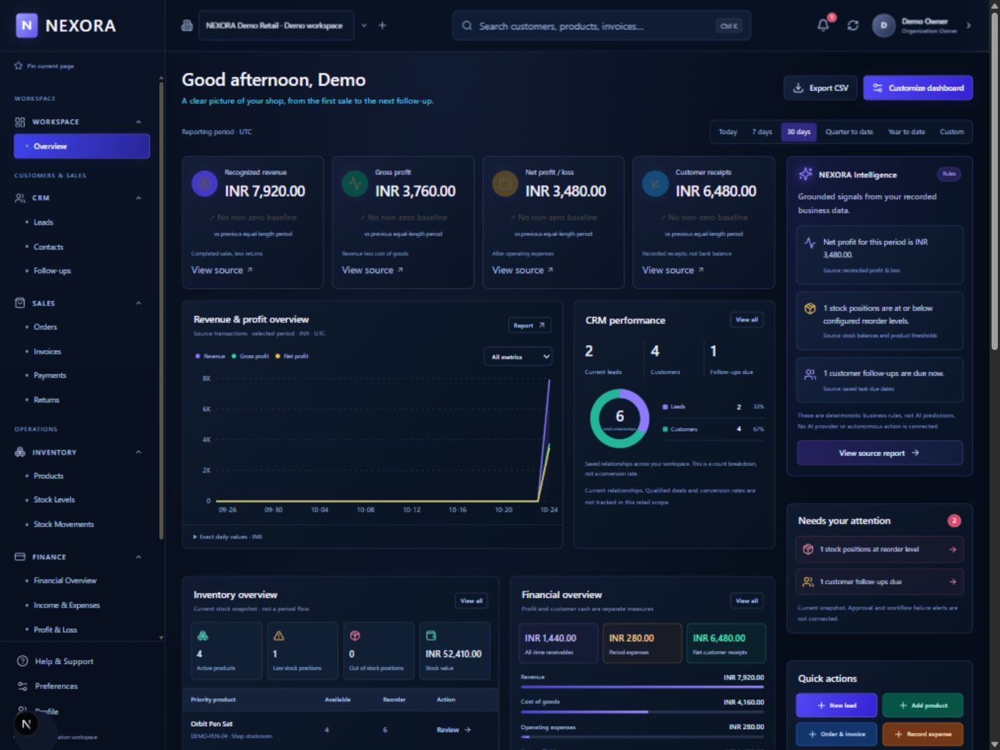
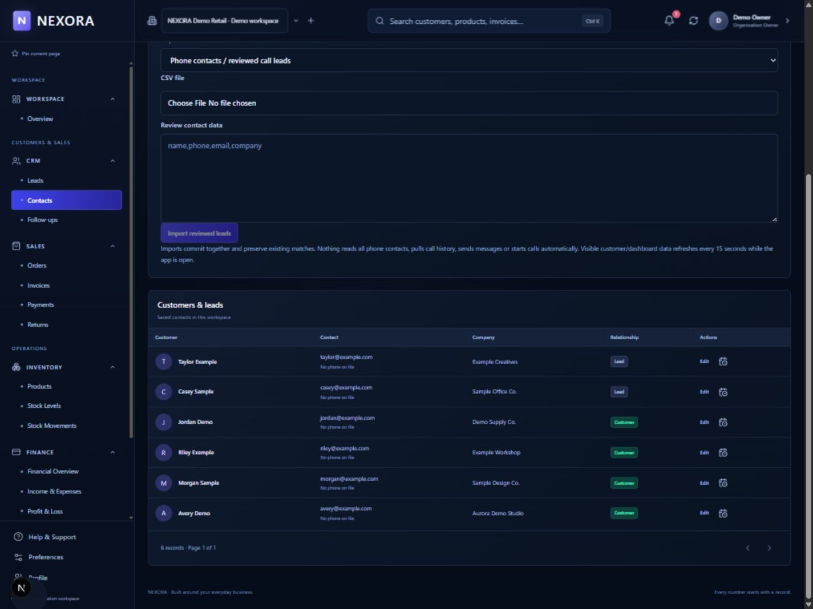
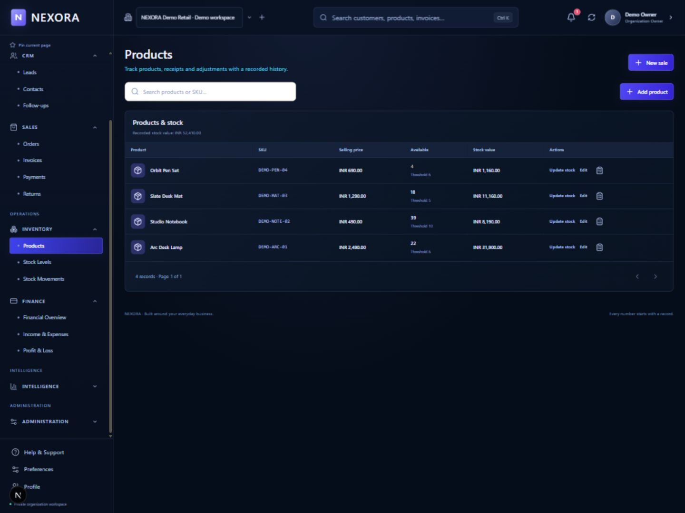
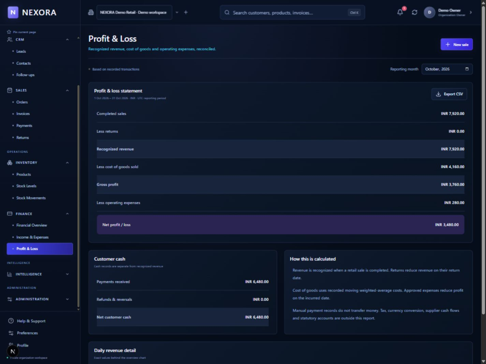

# NEXORA AI OS

A connected retail workspace for customer records, inventory, sales and clear financial reporting.

[View the product case study](https://anchal-sharma-portfolio.brownbloom1024.chatgpt.site/work?project=ai-assisted-development) | [Anchal Sharma's portfolio](https://anchal-sharma-portfolio.brownbloom1024.chatgpt.site/)

## Product overview

NEXORA brings everyday retail records into one local application. A customer connects to a sale; a completed sale connects to stock movement, an invoice and its payment history. Financial reporting explains the effect of those recorded transactions.

## Implemented retail scope

- Customer and lead records, follow-ups and reviewed contact imports.
- Product catalogue, stock receipts, adjustments and movement history.
- Draft and completed sales with linked invoices and recorded payments.
- Partial receipts, returns, refunds and reversals.
- Expenses, financial reporting and CSV export.
- Workspace membership and ownership checks.
- Rule-based business signals linked to source records.

Payments are bookkeeping records. They do not represent live bank transfers. Product demonstrations use fictional records in an isolated workspace.

## Product contribution

An independent product project by Anchal Sharma, focused on product direction, feature requirements, connected workflows and interface clarity.

## Technology

Next.js | React | TypeScript | NestJS | Prisma | PostgreSQL

## Run locally

Use [the local development guide](docs/local-development.md) for prerequisites, configuration and reviewed database setup. Configure a separate development database and private secrets before starting the application. Do not point setup or tests at a valuable database.

The configured local workflow uses `npm run db:check` and `npm run dev`. Source and database verification commands are documented in the repository; recorded results are dated evidence rather than a claim that this checkout was retested today.

## Release status

The implemented retail scope is demonstrated locally. A public hosted deployment has not been verified. A trusted, signed Windows installer and native installation/upgrade acceptance remain release milestones. See [the native release report](docs/NATIVE-DESKTOP-RELEASE-2026-10-22.md).

Keep `.env`, local runtime state, real business data, backups, invoice uploads and private signing material out of the repository and public demonstrations.

## Genuine product screens

These captures come from the actual application running in an isolated fictional workspace. They illustrate product behaviour and are not business-performance claims.

The [product demonstration video](https://anchal-sharma-portfolio.brownbloom1024.chatgpt.site/nexora-laptop-demo.mp4) presents the genuine local application. It is a recording, not an interactive hosted app.
