# Entity Relationship Diagram

```mermaid
erDiagram
  Tenant ||--o{ Organization : owns
  Tenant ||--o{ User : owns
  Tenant ||--o{ Role : defines
  Tenant ||--o{ Permission : defines
  Tenant ||--o{ Workflow : owns
  Tenant ||--o{ Event : emits
  Tenant ||--o{ BusinessModule : configures
  Organization ||--o{ Business : contains
  Organization ||--o{ Workspace : contains
  Organization ||--o{ Team : owns
  Organization ||--o{ Membership : grants
  Organization ||--o{ BillingAccount : bills
  Business ||--o{ Workspace : contextualizes
  Business ||--o{ ModuleSetting : enables
  Business ||--o{ KpiMetric : measures
  Workspace ||--o{ WorkspaceMember : includes
  Workspace ||--o{ Workflow : scopes
  Workspace ||--o{ Event : streams
  Workspace ||--o{ AiConversation : hosts
  Workspace ||--o{ Dashboard : displays
  Workspace ||--o{ Project : manages
  Workspace ||--o{ Task : tracks
  Workspace ||--o{ FileAsset : stores
  User ||--o{ AuthAccount : authenticates
  User ||--o{ Credential : secures
  User ||--o{ Session : opens
  User ||--o{ Membership : belongs
  User ||--o{ WorkspaceMember : joins
  User ||--o{ TeamMember : participates
  User ||--o{ Notification : receives
  User ||--o{ ApiKey : owns
  Team ||--o{ TeamMember : includes
  Team ||--o{ Project : owns
  Role ||--o{ RolePermission : grants
  Permission ||--o{ RolePermission : maps
  Role ||--o{ RoleAssignment : assigns
  Membership ||--o{ RoleAssignment : organization_scope
  WorkspaceMember ||--o{ RoleAssignment : workspace_scope
  Workflow ||--o{ WorkflowExecution : runs
  WorkflowExecution ||--o{ WorkflowStepExecution : steps
  EventBusTopic ||--o{ EventBusSubscription : subscribes
  EventBusTopic ||--o{ Event : receives
  IntegrationProvider ||--o{ Integration : powers
  SubscriptionPlan ||--o{ Subscription : prices
  BillingAccount ||--o{ Subscription : owns
  BillingAccount ||--o{ Invoice : receives
  Subscription ||--o{ UsageRecord : meters
  Subscription ||--o{ Invoice : generates
  AiConversation ||--o{ AiMessage : contains
  AiConversation ||--o{ AiToolCall : invokes
  KpiMetric ||--o{ MetricValue : records
  KpiMetric ||--o{ AiInsight : explains
  Dashboard ||--o{ DashboardWidget : renders
  KpiMetric ||--o{ DashboardWidget : feeds
  BusinessModule ||--o{ ModuleSetting : configures
  CrmAccount ||--o{ CrmContact : has
  CrmAccount ||--o{ CrmDeal : tracks
  FinanceAccount ||--o{ FinanceTransaction : posts
  InventoryItem ||--o{ InventoryMovement : moves
  Document ||--o{ FileAsset : attaches
  Project ||--o{ Task : contains
  ComplianceFramework ||--o{ ComplianceControl : defines
```

## ERD Notes

The ERD is tenant-first and module-aware. CRM, finance, HR, inventory, documents, projects, tasks, AI, analytics, and compliance are modules under a broader adaptive operating system.
